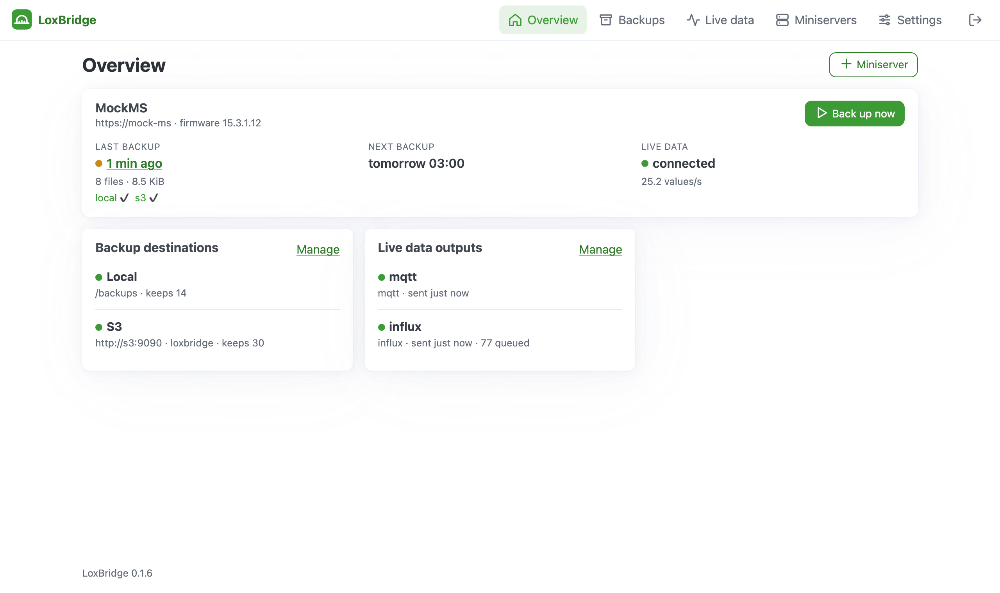
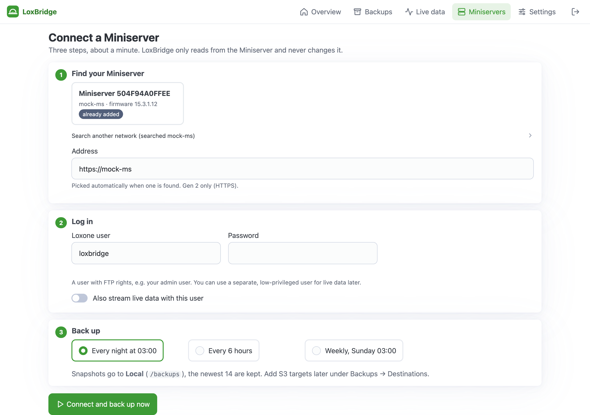
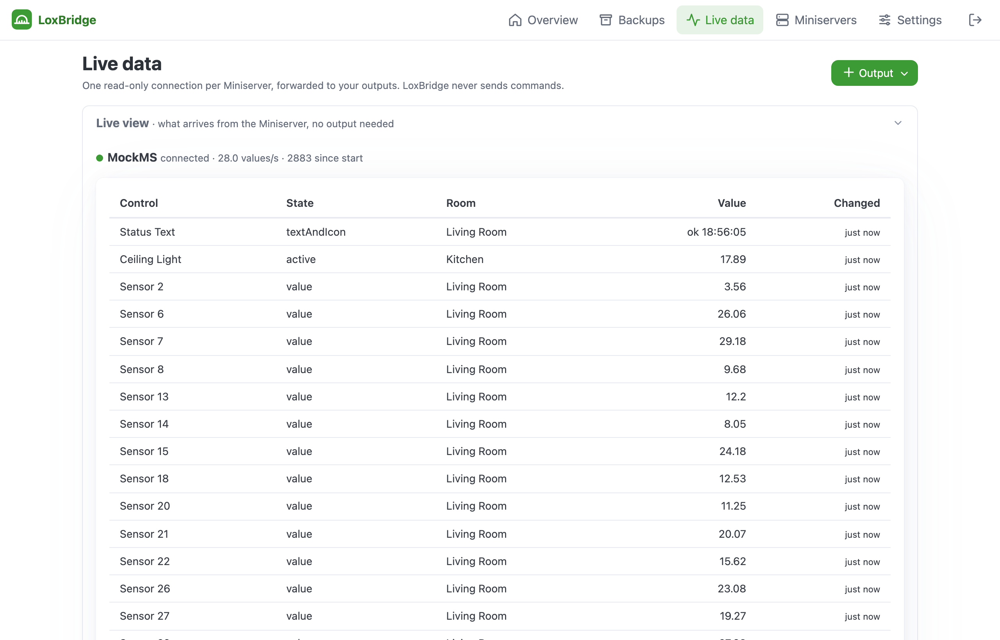
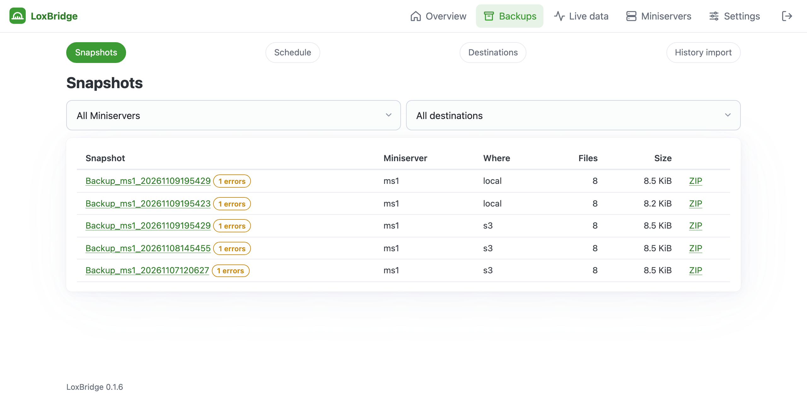
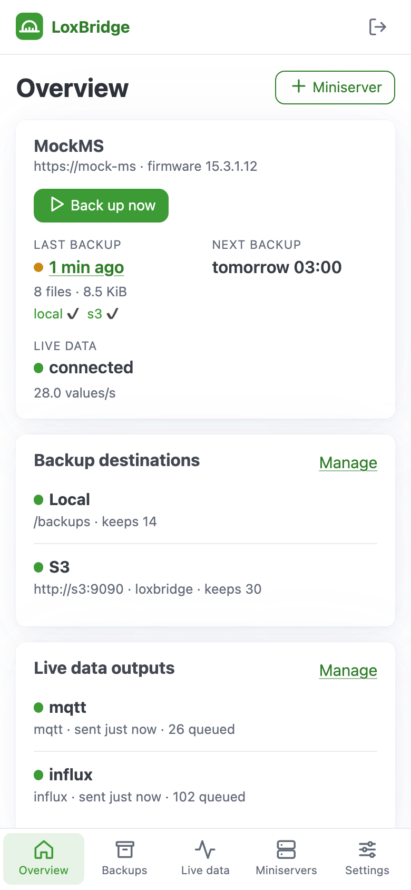

# LoxBridge

Backup and live data proxy for **Loxone Miniserver Gen 2**, packaged as one TrueNAS custom app. Two main jobs:

- **Backups** of the whole SD card (programs, statistics, logs) on a schedule, to a local dataset and any number of
  S3 targets (deduplicated or one archive per snapshot). Browse, download as ZIP, restore, verify, diff.
- **Live data proxy**: one read-only WebSocket connection to the Miniserver, fanned out to InfluxDB /
  VictoriaMetrics, Prometheus `/metrics`, MQTT (with Home Assistant discovery), webhooks and a JSON API.

Extra: **history import** of statistics files from a backup snapshot → InfluxDB (same series as the live data) or CSV,
to backfill Grafana with the time before the proxy ran.

> **Unofficial project.** LoxBridge is an independent community tool and is not affiliated with, endorsed by or in
> any way related to [Loxone Electronics GmbH](https://www.loxone.com). "Loxone" and "Miniserver" are trademarks of
> their respective owner.
>
> **Use at your own risk.** The software is provided "as is", without warranty of any kind (see [LICENSE](LICENSE)).
> The author is not liable for lost or incomplete backups, Miniserver malfunctions, downtime or any other damage
> resulting from its use. Restoring a backup onto a new SD card has not been tested yet.
- **Activity history** under Settings: backups, live data outages, failing outputs, settings changes and logins,
  kept for 90 days.
- Everything is set up in the web UI (works on phone, tablet and desktop); settings live in SQLite, secrets are
  encrypted.

## Screenshots

(Demo data from the mock Miniserver in `tests/`.)

**Overview**: last and next backup, live data status, destinations and outputs at a glance.

<picture>
  <source media="(prefers-color-scheme: dark)" srcset="docs/images/overview-dark.png">
  
</picture>

**Setup**: LoxBridge finds the Miniserver on the network; enter a Loxone user, pick a schedule, done.

<picture>
  <source media="(prefers-color-scheme: dark)" srcset="docs/images/setup-dark.png">
  
</picture>

**Live view**: what arrives from the Miniserver, before any output is set up.

<picture>
  <source media="(prefers-color-scheme: dark)" srcset="docs/images/live-dark.png">
  
</picture>

**Backups**: snapshots per Miniserver, browse, download as ZIP, verify, compare.

<picture>
  <source media="(prefers-color-scheme: dark)" srcset="docs/images/snapshots-dark.png">
  
</picture>

**Phone**: the same app with a bottom tab bar.

<picture>
  <source media="(prefers-color-scheme: dark)" srcset="docs/images/phone-dark.png">
  
</picture>

## Install on TrueNAS

1. Apps → Discover Apps → ⋮ → **Install via YAML**, paste [`compose.yaml`](compose.yaml), replace `tank` with your
   pool name and set `TZ`. No datasets or permissions to prepare: the container creates
   `config`, `work` and `backups` under `/mnt/<pool>/apps/loxbridge/` on first start and hands them to the `apps`
   user (568, override with `PUID`/`PGID`), then runs as that user.
2. Optional: want the backups in their own dataset (own snapshot schedule or quota)? Create it, e.g.
   `tank/backups/loxone`, and put its path on the `/backups` line. Permissions are fixed automatically.
3. Open `http://<truenas>:18568` (or the **Web UI** button in the apps list), and choose a password: the first visit
   sets it (there is only one account, no user name). Change it later under *Settings*; forgot it? Run
   `loxbridge reset-admin` in the app's shell.
   Then **Get started**: LoxBridge searches your network for the Miniserver, you enter a Loxone user and pick a
   schedule, and the first backup runs right away.
4. **Back up `/config/secret.key`** (or set `SECRET_KEY`). Without it the stored passwords can't be decrypted.

Recommended: a periodic ZFS snapshot task on the dataset that holds the backups. Local snapshots are hard-linked, so ZFS snapshots
of them cost almost nothing, and they protect against deletion by the app itself.

| Env var | Purpose |
|---|---|
| `ADMIN_PASSWORD` | optional: preset the password instead of choosing it on the first visit |
| `SECRET_KEY` / `SECRET_KEY_FILE` | key for secret encryption (default: generated `/config/secret.key`) |
| `TZ` | time zone for schedules and statistics timestamps |
| `PORT`, `BASE_URL` | listen port; path prefix when running behind a reverse proxy subpath |
| `LOXBRIDGE_<PATH>` | override any setting, e.g. `LOXBRIDGE_BACKUP__SCHEDULE=04:00`, `LOXBRIDGE_MINISERVERS__0__URL=https://…`. Overridden settings show as locked in the UI. |

Preview builds of `main` (not releases): `ghcr.io/andileeb/loxbridge:edge`. An app for the official TrueNAS catalog is
prepared in [`truenas/`](truenas/README.md) but not submitted yet.

Volumes: `/config` (DB, secret key), `/backups` (local destination), `/work` (staging, S3 index, caches, exports).

## Finding the Miniserver

The setup page probes `https://<ip>/jdev/cfg/apiKey` (needs no login) on the /24 network of the NAS address you
opened the UI with and on your browser's /24, so a Miniserver in another VLAN than the NAS is found as long as your
phone or PC is in that VLAN. Otherwise use *Search another network* (`192.168.3.0/24` or an IP). Loxone's UDP search
and mDNS don't pass the Docker bridge network TrueNAS apps run in, so they aren't used.

## Miniserver users

Create two users in Loxone Config:

- **Backup user**: needs file access to the SD card (`/dev/fslist`, `/dev/fsget`). Used only for backups.
- **Bridge user**: a plain visualisation user without admin rights. The bridge only receives states of controls this
  user can see in the app, and never sends commands.

Separate users keep the always-connected bridge low-privileged. If one user is used for both it works, but the bridge
then runs with file-access rights.

Both use **token auth** (`getkey2` → `getjwt`, Loxone's "Communicating with the Miniserver"). Backups authenticate
each HTTPS request with `?autht=<HMAC(token, one-time key)>&user=…`; the bridge authenticates its WebSocket.
Basic auth is available per Miniserver (*Auth mode: basic*) as a fallback.

**HTTPS and certificates**: Miniserver URLs must be `https://` (Gen 2 only). Gen 2 serves HTTPS with a certificate for its CloudDNS name
`https://<ip-with-dashes>.<serial>.dyndns.loxonecloud.com` (e.g. `192-168-1-77.504F94A0FFEE.dyndns.loxonecloud.com`).
Use that name with *Verify TLS* on, or the IP with *Verify TLS* off (the default).

## Backups

- Schedule: daily times (`03:00, 15:30`) or a cron expression (`0 3 * * 1-5`; weekdays as in standard cron).
- Every run lists the SD card once and downloads only files whose size or date changed. Unchanged files are hard-linked
  from the previous local snapshot (or a staging copy in `/work` if there's no local destination). Each file is read at
  most once per run, sequentially, with an optional delay between requests.
- A snapshot is built in `.inprogress_*` and renamed only when complete; S3 manifests are uploaded last. An interrupted
  run never shows up as a snapshot.
- Each snapshot contains `_manifest.json` (size, date and SHA-256 per file) and `_loxbridge/config.json` (the app
  configuration without secrets).
- Files the Miniserver refuses (e.g. HTTP 500 on a locked log) are listed as errors; the run is then `partial`.

### S3

Add as many S3 targets as you like (e.g. MinIO/Garage on the NAS plus one cloud bucket, each with its own mode
and retention). Each run pulls from the Miniserver once and pushes to every target independently. Pick a preset on
*Destinations → Add S3* (AWS, Backblaze B2, Wasabi, Hetzner, Cloudflare R2, MinIO) and press *Test*
(writes, reads and deletes a probe object).

- **dedup** (default): `<prefix>/<ms>/blobs/sha256/ab/cd/<hash>` stored once, `snapshots/<snapshot>.json` manifests,
  `latest.json`. An unchanged run uploads 0 blobs. Retention keeps the newest N manifests; the nightly GC (04:45)
  deletes unreferenced blobs older than 24 h. Deletes blocked by Object Lock are logged as warnings.
- **archive**: one `archives/<snapshot>.tar.gz` per snapshot.

Minimal IAM policy:

```json
{"Version": "2012-10-17", "Statement": [
  {"Effect": "Allow", "Action": ["s3:ListBucket"], "Resource": "arn:aws:s3:::BUCKET"},
  {"Effect": "Allow", "Action": ["s3:GetObject", "s3:PutObject", "s3:DeleteObject"],
   "Resource": "arn:aws:s3:::BUCKET/loxbridge/*"}]}
```

### Restore

- UI: *Snapshots → snapshot → Restore to folder* (e.g. `/backups/restore/<snapshot>`), or *Download ZIP*.
- CLI: `python -m loxbridge restore <ms> <snapshot> /backups/restore/x --dest s3`.
- Then copy the files back to the SD card (Loxone Config → SD card / file manager), or open the newest
  `prog/sps_*.zip` / `.LoxCC` in Loxone Config and save it to the Miniserver.

`verify [--deep]`, `gc`, `list`, `once` and `check` are available on the CLI too (`python -m loxbridge --help`).

## Data bridge

1. *Miniservers*: enable *Bridge*, set the bridge user, *Test* (logs in, reads the structure file, shows serial and
   firmware).
2. *Live data*: add an output, then tick the controls it exports (search, filter by room, category or type, tick all
   shown).
3. Per output: change filter (*deadband*, *heartbeat*), batching, queue size. Each output has its own queue; when it
   overflows the oldest values are dropped and counted (`loxbridge_sink_dropped_total`). A slow or broken output
   never blocks the others.

| Output | Format |
|---|---|
| InfluxDB v2 / v1 / VictoriaMetrics | measurement `loxone`, tags `miniserver, room, category, control, state, type, uuid`, field `value` |
| Prometheus | `loxone_state{miniserver,room,category,control,state,type}` on `/metrics` |
| MQTT | `loxbridge/<ms>/<room>/<control>/<state>` (slugified), retained, JSON or plain; LWT `loxbridge/status`; optional HA discovery |
| Webhook | POST `{"points": [...]}`, header `X-LoxBridge-Signature: sha256=<HMAC of the body>` |
| JSON API | `GET /api/v1/states`, `/api/v1/controls`, `/api/v1/states/{uuid}/history?from=-7d` (InfluxDB) |

Text states (e.g. status texts) go to MQTT and the API; enable *Include text* to also send them to InfluxDB/webhooks.

### History import (extra)

*History*: pick a snapshot, controls and time range; target InfluxDB or CSV. Statistics files are read from the
backup, not from the Miniserver. Points carry the same tags as the live data, so Grafana shows one series, and
re-importing overwrites (no duplicates). *Backup → Auto import history* imports new statistics after every backup,
incrementally.

> The statistics file parser follows the community-documented binary layout and has only been tested with
> synthetic files. Files that don't match are skipped with a warning (see the job log). Please report the result
> with a real snapshot.

## Grafana

`examples/grafana/` has datasource provisioning (InfluxDB with Flux, uid `loxbridge-influx`; Prometheus, uid
`loxbridge-prometheus`) and three dashboards: *Loxone overview*, *Loxone energy*, *LoxBridge health*.
[`examples/compose.monitoring.yaml`](examples/compose.monitoring.yaml) starts InfluxDB + Prometheus + Grafana with
them; on TrueNAS you can also install those as separate apps and copy the provisioning files.

## API and metrics

API tokens: *Settings → API tokens*, then `Authorization: Bearer <token>`. OpenAPI docs: `/api/docs`.
`/metrics` always has the app metrics (`loxbridge_backup_last_success_timestamp`, `_duration_seconds`, `_bytes`,
`_errors`, `loxbridge_ws_connected`, `loxbridge_sink_*`); set a metrics token in *Settings* to protect it.

## Security

Built for the LAN. If you expose it, put it behind HTTPS (TrueNAS reverse proxy, Traefik or Caddy app). Sessions are
HttpOnly/SameSite=Lax cookies, forms carry CSRF tokens, logins are rate limited (5 per 5 minutes per IP), passwords
are argon2 hashes. Secrets are Fernet-encrypted in the DB, never shown again in the UI and never logged.
For Authelia/Authentik set *Settings → Proxy header* (e.g. `Remote-User`) and the proxy's IP in *Trusted proxies*.

## Development

```sh
uv sync -p 3.13
uv run pytest -q                       # unit, moto S3, mock Miniserver (HTTP + WebSocket), web
docker compose -f compose.dev.yaml up -d --build   # app + mock Miniserver + S3 + Mosquitto + InfluxDB + Grafana
E2E_BASE_URL=http://localhost:8080 uv run pytest tests/e2e   # Playwright (uv run playwright install chromium)
```

`tests/mock_ms.py` is a fake Miniserver (user `admin:secret`) with token auth, fslist/fsget, a structure file and
binary state events; `--extra-controls 50` adds sensors for load tests.

Measured in the dev stack (one Miniserver, 54 controls exported to InfluxDB, MQTT and Prometheus, ~27 changes/s):
about 80 MiB RSS and 1–3 % of one core.

## Releases

Push a `vX.Y.Z` tag (it must match `pyproject.toml`, `loxbridge/__init__.py` and the image tag in `compose.yaml`).
`.github/workflows/release.yml` runs the tests, pushes `ghcr.io/andileeb/loxbridge:X.Y.Z` (+ `X.Y`, `latest`) for
amd64 and arm64, and drafts a GitHub release with `compose.yaml` attached; review the notes and publish it.

## License

MIT — see [LICENSE](LICENSE). Not affiliated with Loxone Electronics GmbH. Provided as is, without warranty; use at
your own risk.

Built with the help of [Claude Code](https://claude.com/claude-code).
